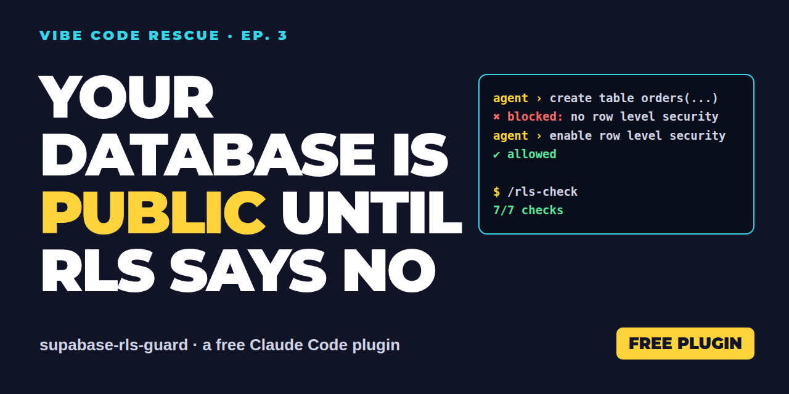

<div align="center">



# supabase-rls-guard

**Your Lovable app's database may be open to anyone. This stops your AI agent from shipping it that way.**<br>
A free Claude Code plugin from *Vibe Code Rescue* episode 3.

[](../../LICENSE)
[](#-install)
[](#-install)

[Install](#-install) · [What it blocks](#-what-it-blocks) · [Audit your app](#-audit-your-app) · [Live SQL check](#-live-sql-check) · [Checklist](#-the-7-point-checklist)

</div>

---

## 🔥 Why this exists

Researchers scanned **159,041 Lovable apps**. Of the **34,545** that store data in Supabase, **24,664** returned database records to someone who never logged in. Emails were readable on 7,403 sites; one database held 1,000+ passport records; a forum leaked 200,000+ private messages. ([Cybernews](https://cybernews.com/security/lovable-ai-apps-expose-personal-information/))

Nobody hacked Lovable or Supabase. The apps had no **Row Level Security**, the rule that decides who may see which rows. Your app hands the anon key to every browser by design, and tables your AI agent creates with SQL don't get RLS by default.

## ⚡ Install

In Claude Code:

```bash
/plugin marketplace add mgmehdiforme/vibe-code-rescue
/plugin install supabase-rls-guard@vibe-code-rescue
```

You need `python3` 3.8+ and nothing else: no pip, no npm, no API key, no database password.

## 🛡 What it blocks

| When your agent… | What happens |
|---|---|
| writes a migration that creates a table without `enable row level security` | **Blocked.** It's told to enable RLS in the same migration and add a policy per operation. |
| writes a policy that lets anyone insert / update / delete with `using (true)` | **Blocked.** It's told to restrict it to the row owner. |
| puts a `service_role` JWT or `sb_secret_` key in browser code, or a secret in a `VITE_` / `NEXT_PUBLIC_` / `EXPO_PUBLIC_` variable | **Blocked.** That key bypasses RLS; it belongs in an Edge Function or backend. |
| creates a table that is meant to be public (e.g. `countries`) | Add `-- rls-guard: allow` to that SQL file, or a glob to `.rlsguardignore`. |

Set `RLS_GUARD_MODE=ask` to get a prompt instead of a block, or `off` to disable.

## 🔍 Audit your app

```bash
/rls-check
```

or ask *"can strangers read my Supabase data?"*. The `rls-auditor` agent reads your migrations, policies, views, RPC functions and front-end queries, and returns the 7-point checklist with file:line evidence and the SQL to fix each finding.

Without Claude Code (also works in CI, exits 1 on a critical finding):

```bash
python3 scripts/scan.py path/to/your/app
```

## 🧪 Live SQL check

Migrations don't show tables created in the dashboard. Paste [`sql/rls-check.sql`](sql/rls-check.sql) into **Supabase › SQL Editor** and run it. It is read-only. Every row it returns is a finding:

| finding | meaning |
|---|---|
| `rls_off` | table has no RLS: anyone with the anon key can use it |
| `rls_on_no_policy` | locked for everyone (intended?) |
| `write_policy_true` | a policy lets every row be written |
| `anon_write_grant` | anon can still insert/update/delete (policies don't remove grants) |
| `view_skips_rls` | view runs as owner and ignores RLS |
| `security_definer_fn` | function skips RLS: check its access logic |

The 10-second version:

```sql
select tablename from pg_tables where schemaname = 'public' and not rowsecurity;
```

## ✅ The 7-point checklist

1. Every public table has RLS enabled (the query above returns zero rows), and views are checked separately.
2. Every table has a policy for each operation you allow: select, insert, update, delete.
3. `anon` has no grants on tables that need a login.
4. The `service_role` / `sb_secret_` key is not in the browser bundle or any public env variable.
5. You tested logged out, and as user A reading user B's data.
6. A human read every policy the AI generated, looking for inverted logic.
7. You re-run the check after every AI change that creates or alters a table.

## 🎬 The episode

**Video:** https://www.youtube.com/watch?v=Mpbfc2Rt0CY
**Sources:** [Cybernews](https://cybernews.com/security/lovable-ai-apps-expose-personal-information/) · [UpGuard](https://www.upguard.com/labs/research/everything-everywhere-systemic-data-exposure-in-supabase-apps) · [The Register](https://www.theregister.com/2026/02/27/lovable_app_vulnerabilities) · [Supabase RLS docs](https://supabase.com/docs/guides/database/postgres/row-level-security)

## ❓ FAQ

**Is the anon key a secret?** No. It's meant to be public. RLS is what makes that safe.<br>
**Does it read my `.env`?** Only the variable *names* in `.env*` files are checked for public prefixes; values are never printed.<br>
**Does it connect to my database?** No. The live check is SQL you run yourself in the Supabase editor.<br>
**False positive?** `-- rls-guard: allow` in the SQL file, a glob in `.rlsguardignore`, or `RLS_GUARD_MODE=ask`.

## 🧰 What's inside

```
.claude-plugin/plugin.json      plugin manifest
hooks/hooks.json                PreToolUse hook on Write | Edit | MultiEdit
scripts/guard.py                the hook
scripts/scan.py                 project scanner (CLI + CI)
scripts/rls_lib.py              shared checks
sql/rls-check.sql               live, read-only database check
skills/supabase-rls-audit/      how RLS works + fix recipes
commands/rls-check.md           /rls-check
agents/rls-auditor.md           read-only reviewer agent
tests/test_rls.py               python3 tests/test_rls.py
```

---

Built by **Mehdi Golzari**. I take AI-built apps from prototype to production.
Want a human to check your app? → [Fix & Launch your AI-built app](https://www.fiverr.com/mehdigolzari/fix-secure-and-launch-your-ai-built-app-from-claude-code-cursor-or-lovable)
