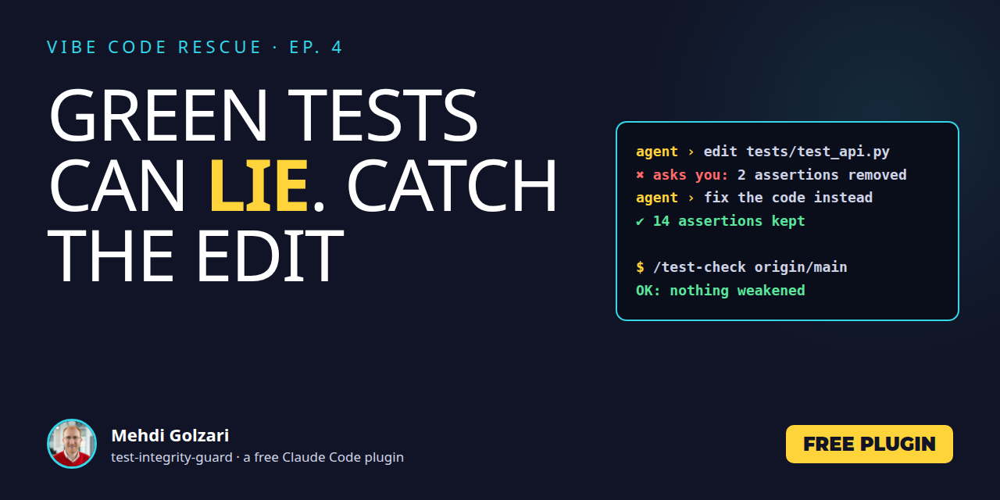

<div align="center">



# test-integrity-guard

**Your AI agent can turn a red test green by making the test check less. This makes it ask you first.**<br>
A free Claude Code plugin from *Vibe Code Rescue* episode 4.

[](../../LICENSE)
[](#-install)
[](#-install)

[Install](#-install) · [What it catches](#-what-it-catches) · [Check your repo](#-check-your-repo) · [Checklist](#-the-7-point-checklist)

</div>

---

## 🔥 Why this exists

Anthropic used Claude to help port its Messages API from Python to Rust, including about **700 integration tests**. The tests had to change along with the code, so a pass could mean the code was right, *or* that the test had been changed so wrong code got through. When they audited the ported tests, they found **more than 100 weakened assertions**. In April the Rust API passed **about 98%** of its tests, yet only **about a quarter** of inputs matched on production traffic. ([Anthropic, 25 Nov 2026](https://www.anthropic.com/research/migrating-api-to-rust))

Nobody broke the build. The tests were green. They just checked less than before. If an AI agent writes your code *and* edits your tests, "all tests pass" is not proof anymore.

## ⚡ Install

In Claude Code:

```bash
/plugin marketplace add mgmehdiforme/vibe-code-rescue
/plugin install test-integrity-guard@vibe-code-rescue
```

You need `python3` 3.8+ and nothing else: no pip, no npm, no API key. Works with Python, JS/TS, C#/.NET, Go, Java/Kotlin, Rust, Ruby, PHP and Swift test files.

## 🛡 What it catches

Before Claude Code edits a file or runs a command, the hook compares the test file before and after. If the change makes your tests check less, **you get asked** with the exact reason, and the agent is told to fix the code instead.

| When your agent… | Example |
|---|---|
| removes or comments out assertions | `- assert order.currency == "EUR"` |
| swaps a strict check for a loose one | `toEqual('…')` → `toBeTruthy()`, `assertEqual` → `assertIsNotNone` |
| switches a test off | `it.skip`, `xit`, `@pytest.mark.skip`, `[Fact(Skip = …)]`, `t.Skip()`, `#[ignore]`, `@Disabled` |
| adds a focus marker that silences the rest | `it.only`, `fdescribe` |
| adds an assertion that can never fail | `assert True`, `expect(true).toBe(true)` |
| swallows the error under test | `except: pass`, `catch {}` |
| makes the test run unable to fail | `npm test \|\| true`, `--passWithNoTests`, `pytest -k "not …"`, `jest -u` |
| deletes test files | `rm tests/test_api.py`, `git rm src/order.test.ts` |
| lets CI ignore red tests | `continue-on-error: true`, `allow_failure: true` |

Adding tests, adding assertions and refactoring that keeps every check is never interrupted.

Modes: `TEST_GUARD_MODE=ask` (default, you approve), `block` (the agent is refused: good for headless runs), `off`. Skip files with globs in `.testguardignore`.

## 🔍 Check your repo

```bash
/test-check origin/main
```

or ask *"did Claude change my tests?"*. The `test-auditor` agent reads every changed test, writes one sentence per change ("before, this failed when X; now only when Y"), and also looks for what a script can't see: expected values edited to match new output, raised tolerances, mocks that replace the code under test, and production code that special-cases test input.

Without Claude Code (also works in CI, exits 1 when a test got weaker):

```bash
python3 scripts/scan.py . --base origin/main
python3 scripts/scan.py . --snapshot     # what is skipped, focused or always-true today
```

The 2-minute check with plain git:

```bash
git diff origin/main -- '*test*' '*spec*' | grep -E '^-.*(assert|expect|Assert\.|should)'
git diff origin/main -- '*test*' '*spec*' | grep -E '^\+.*(\.skip|xit\(|\.only|@pytest\.mark\.skip|Skip *=|t\.Skip|#\[ignore\]|@Disabled)'
```

Every line either command prints needs a reason a human agreed to.

## ✅ The 7-point checklist

1. Read the test diff before the code diff in every AI-written PR.
2. No assertion was removed or loosened without a written reason a human approved.
3. No new skip / only / ignore markers in the suite.
4. The test command can fail: no `|| true`, `--passWithNoTests`, `continue-on-error`, deselected tests.
5. Expected values come from the spec or the old system, never from the new code's output.
6. Before switching, compare old vs new on real (anonymised) inputs, not only on tests.
7. Every correction you make to the agent becomes a rule it reads (CLAUDE.md) and a test or lint.

## 🎬 The episode

**Video:** <YOUTUBE_URL>
**Source:** [Anthropic, "Migrating the Messages API to Rust"](https://www.anthropic.com/research/migrating-api-to-rust)

## ❓ FAQ

**Will it stop legit test changes?** No, it asks. Say yes when the test was really wrong; the point is that a human decides, not the agent.<br>
**Does it run my tests or send code anywhere?** No. It reads the file before and after the edit, locally, with the Python standard library.<br>
**Can I use it without Claude Code?** Yes: `scripts/scan.py` in CI on every PR, with `--base origin/main`.<br>
**Does it catch an expected value edited to match wrong output?** Not by pattern (both sides are still assertions). That's what `/test-check` and the `test-auditor` agent look for.

## 🧰 What's inside

```
.claude-plugin/plugin.json        plugin manifest
hooks/hooks.json                  PreToolUse hook on Write | Edit | MultiEdit | Bash
scripts/guard.py                  the hook
scripts/scan.py                   git-diff + snapshot scanner (CLI + CI)
scripts/tig_lib.py                shared checks
skills/test-integrity-audit/      what weakened tests look like + fix recipes
commands/test-check.md            /test-check
agents/test-auditor.md            read-only reviewer agent
tests/test_guard.py               python3 tests/test_guard.py
```

---

Built by **Mehdi Golzari**. I take AI-built apps from prototype to production.
Want a human to check your AI-built app before launch? → [Fix & Launch your AI-built app](https://www.fiverr.com/mehdigolzari/fix-secure-and-launch-your-ai-built-app-from-claude-code-cursor-or-lovable)
